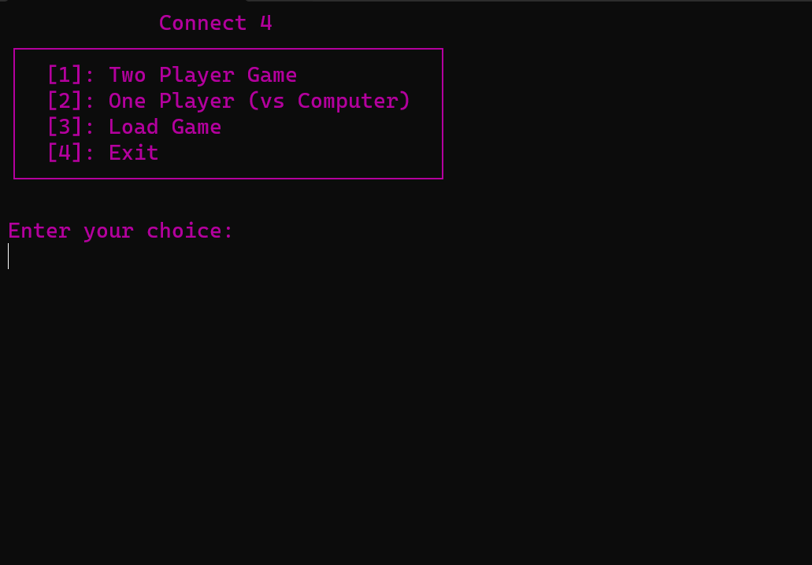
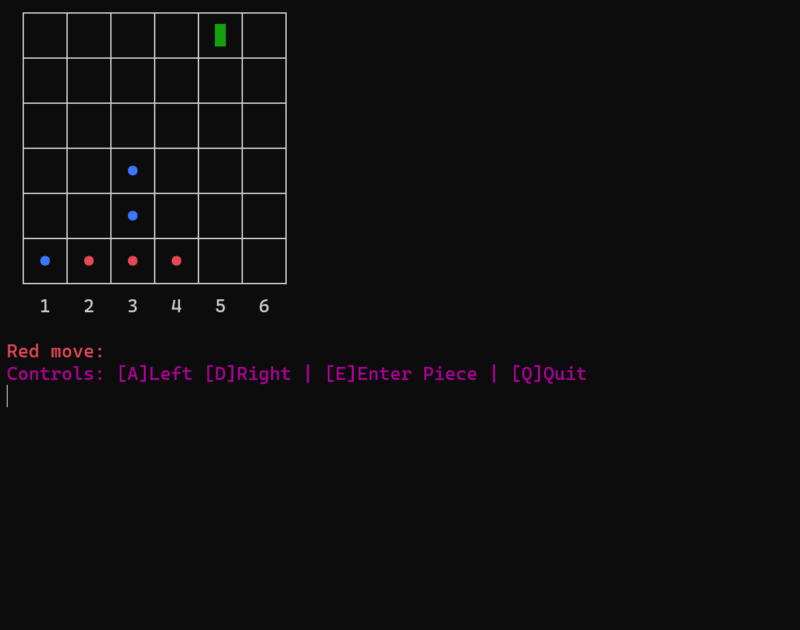
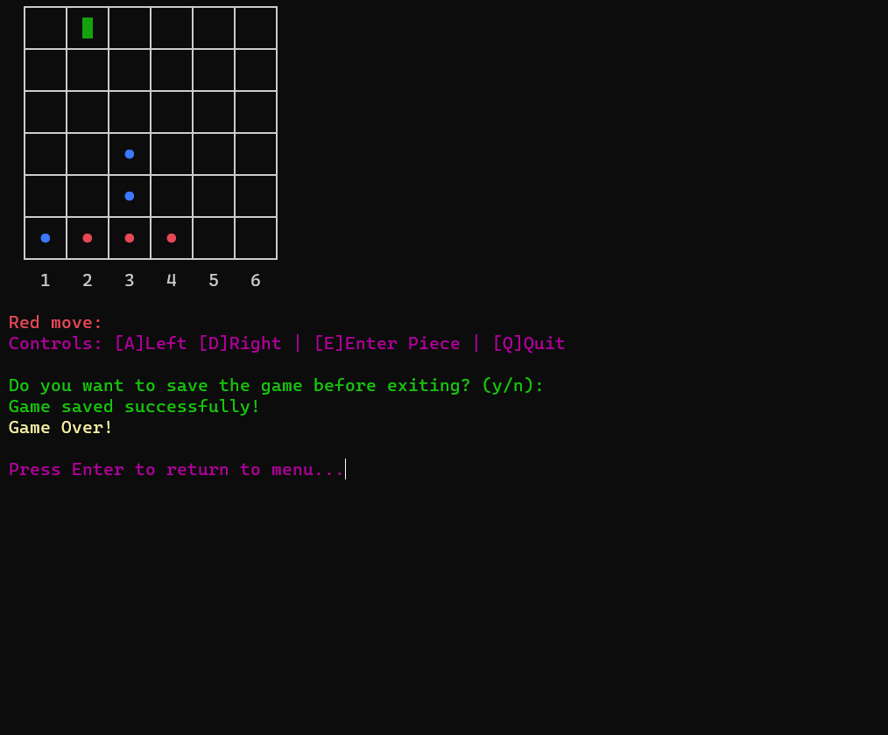
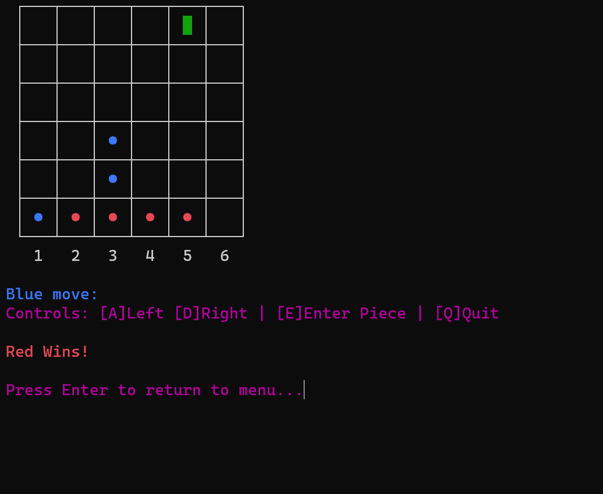

````markdown
# Connect 4 — Terminal Edition


A classic **Connect 4** game for the Windows terminal, written in pure Python. Play against a friend on the same keyboard, challenge the built-in computer opponent, and save your match to continue later.

---

## 🖼️ Screenshots

| Main Menu | Gameplay |
|:---:|:---:|
|  |  |

| Saving a Game | Victory |
|:---:|:---:|
|  |  |

---

## ✨ Features

- **Two-player mode** for local play on a single keyboard
- **One-player mode** against a computer opponent
- **Save and load** your game at any point
- **Win detection** for horizontal, vertical, and both diagonal lines
- **Draw detection**, including early draws when no player can still connect four
- **Colored terminal interface** with a movable cursor for column selection

---

## 📋 Requirements

- **Windows** (the game uses `msvcrt`, which is Windows-only)
- **Python 3.8** or newer
- The [`keyboard`](https://pypi.org/project/keyboard/) library

---

## ⚙️ Installation

1. Clone the repository:

   ```bash
   git clone https://github.com/FarnazZS/Connect4.git
   cd Connect4
   ```

2. Install the dependencies:

   ```bash
   pip install -r requirements.txt
   ```

---

## 🚀 Usage

Run the game from the project folder:

```bash
python C4.py
```

> The game saves and loads `save.json` from the current working directory, so always launch it from the project folder.

### Main Menu

| Key | Action |
|:---:|--------|
| `1` | Start a two-player game |
| `2` | Start a one-player game (vs. computer) |
| `3` | Load a saved game |
| `4` | Exit |

### In-Game Controls

| Key | Action |
|:---:|--------|
| `A` | Move cursor left |
| `D` | Move cursor right |
| `E` | Drop a piece in the selected column |
| `Q` | Quit (you will be asked whether to save first) |

> **Note:** If key presses are not detected, try running the terminal as administrator. The `keyboard` library relies on low-level input hooks.

---

## 🧠 How It Works

- The board is a **6 × 6** grid stored as a 2D list.
- Pieces fall to the lowest empty cell of the chosen column.
- After every move, the game checks for a winning line, an early draw, or a full board.
- **Computer opponent:** it first looks for a move that wins immediately, then a move that blocks the player from winning. If neither exists, it prefers the center columns.
- Saved games are stored as JSON in `save.json`.

---

## 📁 Project Structure

```
Connect4/
├── C4.py                # Main game file
├── requirements.txt     # Python dependencies
├── LICENSE              # MIT License
├── .gitignore           # Files excluded from version control
├── README.md            # Project documentation
└── screenshots/         # Images used in this README
    ├── menu.png
    ├── play.png
    ├── save.png
    └── win.png
```

---

## 🗺️ Roadmap

Planned improvements for future versions:

- [ ] **Cross-platform support**: replace `msvcrt` with a cross-platform input method so the game runs on Linux and macOS
- [ ] **Multiple save slots**: currently there is only one `save.json`, so a new save overwrites the old one
- [ ] **Smarter computer opponent**: use the Minimax algorithm with alpha-beta pruning instead of the current simple heuristic
- [ ] **Difficulty levels**: Easy, Medium, and Hard computer modes
- [ ] **Undo move**: take back the last move during a game
- [ ] **Score tracking**: keep win/loss/draw statistics across games
- [ ] **Sound effects**: audio feedback for piece drops and wins
- [ ] **Unit tests**: test the win and draw detection functions
- [ ] **Mouse support**: click a column instead of using only the keyboard

Have an idea? Feel free to open an issue or submit a pull request.

---

## 📄 License

This project is licensed under the **MIT License**. See the [LICENSE](LICENSE) file for details.

---

## 👩‍💻 Author

**Farnaz Zarrabi Shirabad** — [@FarnazZS](https://github.com/FarnazZS)
````